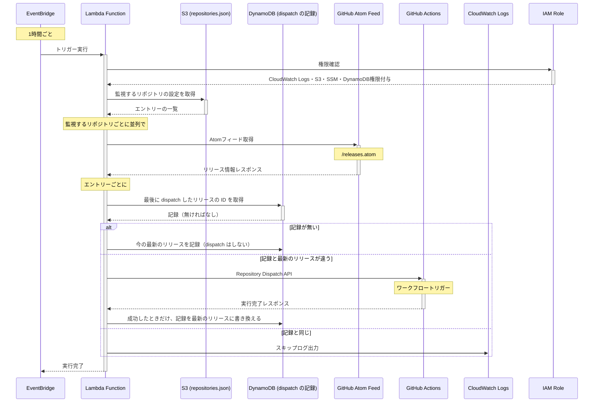

# Feed Release Module

このモジュールは、GitHubリポジトリのAtomフィードを監視し、新しいリリースが検出された場合にGitHub Actionsワークフローをトリガーするaws Lambdaアプリケーションを管理します。

## 機能

- **自動スケジュール実行**: EventBridgeで1時間ごとに実行（ルールは1つ）
- **複数リポジトリ監視**: 監視するリポジトリの設定をS3のJSONに置き、Lambdaが実行のたびに読む。設定を書き換えれば次の実行から反映される（Terraformの実行は不要）
- **並列処理**: リポジトリごとのフィード取得とdispatchをスレッドで並列に行う。同じリポジトリを監視するエントリーはフィード取得を1回にまとめる
- **取りこぼさない判定**: エントリーごとに、最後にdispatchできたリリースのIDをDynamoDBに記録し、最新のリリースのIDが記録と違えばdispatchする。記録はdispatchに成功したときだけ書き換えるので、失敗したエントリーは次の実行でやり直される
- **GitHub API統合**: Repository Dispatch APIでワークフローをトリガー。`client_payload` にリリースのタグ（`tag`）とURL（`url`）を入れる
- **セキュリティ考慮**: 最小権限IAMロールとsensitive変数保護
- **リソース管理**: AWS Resource Groupsによる一元管理
- **ログ記録**: CloudWatch Logsで実行ログを保存

## 使用方法

```hcl
module "feed_release" {
  source = "./modules/feed-release"

  # 必須変数
  lambda_zip_path         = var.lambda_zip_path
  lambda_source_code_hash = var.lambda_source_code_hash

  # 監視するリポジトリの設定を置く S3 バケット（設定の中身は feed-release CLI で管理する）
  config_bucket_name = "prod-feed-release-invoke-workflow"

  # エントリーごとに、最後に dispatch できたリリースを記録する DynamoDB テーブル
  state_table_name = "prod-feed-release-invoke-workflow-state"

  # オプション変数
  lambda_function_name = "feed-release"
  schedule_expression  = "rate(1 hour)"
  lambda_timeout       = 60
  lambda_memory_size   = 128

  tags = {
    Environment = "production"
    ManagedBy   = "terraform"
    Project     = "feed-release"
  }
}
```

## アーキテクチャ



<!-- BEGIN_TF_DOCS -->
## Requirements

| Name | Version |
|------|---------|
| <a name="requirement_terraform"></a> [terraform](#requirement\_terraform) | >= 1.2.0 |
| <a name="requirement_aws"></a> [aws](#requirement\_aws) | ~> 5.92 |

## Providers

| Name | Version |
|------|---------|
| <a name="provider_aws"></a> [aws](#provider\_aws) | ~> 5.92 |

## Modules

No modules.

## Resources

| Name | Type |
|------|------|
| [aws_cloudwatch_event_rule.schedule](https://registry.terraform.io/providers/hashicorp/aws/latest/docs/resources/cloudwatch_event_rule) | resource |
| [aws_cloudwatch_event_target.lambda_target](https://registry.terraform.io/providers/hashicorp/aws/latest/docs/resources/cloudwatch_event_target) | resource |
| [aws_cloudwatch_log_group.lambda_log_group](https://registry.terraform.io/providers/hashicorp/aws/latest/docs/resources/cloudwatch_log_group) | resource |
| [aws_dynamodb_table.state](https://registry.terraform.io/providers/hashicorp/aws/latest/docs/resources/dynamodb_table) | resource |
| [aws_iam_role.lambda_role](https://registry.terraform.io/providers/hashicorp/aws/latest/docs/resources/iam_role) | resource |
| [aws_iam_role_policy.lambda_policy](https://registry.terraform.io/providers/hashicorp/aws/latest/docs/resources/iam_role_policy) | resource |
| [aws_iam_role_policy_attachment.lambda_basic_execution](https://registry.terraform.io/providers/hashicorp/aws/latest/docs/resources/iam_role_policy_attachment) | resource |
| [aws_lambda_function.feed_release](https://registry.terraform.io/providers/hashicorp/aws/latest/docs/resources/lambda_function) | resource |
| [aws_lambda_permission.allow_eventbridge](https://registry.terraform.io/providers/hashicorp/aws/latest/docs/resources/lambda_permission) | resource |
| [aws_resourcegroups_group.feed_release](https://registry.terraform.io/providers/hashicorp/aws/latest/docs/resources/resourcegroups_group) | resource |
| [aws_resourcegroups_group.feed_release_all](https://registry.terraform.io/providers/hashicorp/aws/latest/docs/resources/resourcegroups_group) | resource |
| [aws_s3_bucket.config](https://registry.terraform.io/providers/hashicorp/aws/latest/docs/resources/s3_bucket) | resource |
| [aws_s3_bucket_lifecycle_configuration.config](https://registry.terraform.io/providers/hashicorp/aws/latest/docs/resources/s3_bucket_lifecycle_configuration) | resource |
| [aws_s3_bucket_public_access_block.config](https://registry.terraform.io/providers/hashicorp/aws/latest/docs/resources/s3_bucket_public_access_block) | resource |
| [aws_s3_bucket_versioning.config](https://registry.terraform.io/providers/hashicorp/aws/latest/docs/resources/s3_bucket_versioning) | resource |
| [aws_caller_identity.current](https://registry.terraform.io/providers/hashicorp/aws/latest/docs/data-sources/caller_identity) | data source |
| [aws_region.current](https://registry.terraform.io/providers/hashicorp/aws/latest/docs/data-sources/region) | data source |

## Inputs

| Name | Description | Type | Default | Required |
|------|-------------|------|---------|:--------:|
| <a name="input_cloudwatch_log_retention_days"></a> [cloudwatch\_log\_retention\_days](#input\_cloudwatch\_log\_retention\_days) | CloudWatch log retention period in days | `number` | `14` | no |
| <a name="input_config_bucket_name"></a> [config\_bucket\_name](#input\_config\_bucket\_name) | Name of the S3 bucket that holds the repositories config | `string` | `"prod-feed-release-invoke-workflow"` | no |
| <a name="input_config_noncurrent_versions_to_keep"></a> [config\_noncurrent\_versions\_to\_keep](#input\_config\_noncurrent\_versions\_to\_keep) | Number of noncurrent versions of the repositories config to keep in the S3 bucket | `number` | `10` | no |
| <a name="input_config_object_key"></a> [config\_object\_key](#input\_config\_object\_key) | Key of the repositories config (JSON) in the S3 bucket | `string` | `"repositories.json"` | no |
| <a name="input_create_comprehensive_resource_group"></a> [create\_comprehensive\_resource\_group](#input\_create\_comprehensive\_resource\_group) | Whether to create a comprehensive resource group that includes all AWS resources | `bool` | `false` | no |
| <a name="input_github_token_parameter_name"></a> [github\_token\_parameter\_name](#input\_github\_token\_parameter\_name) | Name of the SSM parameter (SecureString) holding the GitHub API token for triggering workflow dispatch | `string` | `"/app/feed-release-invoke-workflow/gh-token-for-dispatch"` | no |
| <a name="input_lambda_function_name"></a> [lambda\_function\_name](#input\_lambda\_function\_name) | Name of the Lambda function | `string` | `"feed-release"` | no |
| <a name="input_lambda_memory_size"></a> [lambda\_memory\_size](#input\_lambda\_memory\_size) | Lambda function memory size in MB | `number` | `128` | no |
| <a name="input_lambda_source_code_hash"></a> [lambda\_source\_code\_hash](#input\_lambda\_source\_code\_hash) | Base64 encoded hash of the Lambda zip file | `string` | n/a | yes |
| <a name="input_lambda_timeout"></a> [lambda\_timeout](#input\_lambda\_timeout) | Lambda function timeout in seconds | `number` | `60` | no |
| <a name="input_lambda_zip_path"></a> [lambda\_zip\_path](#input\_lambda\_zip\_path) | Path to the Lambda deployment zip file | `string` | n/a | yes |
| <a name="input_resource_group_name"></a> [resource\_group\_name](#input\_resource\_group\_name) | Name of the AWS Resource Group | `string` | `"feed-release-resources"` | no |
| <a name="input_schedule_expression"></a> [schedule\_expression](#input\_schedule\_expression) | EventBridge schedule expression for checking releases | `string` | `"rate(1 hour)"` | no |
| <a name="input_state_table_name"></a> [state\_table\_name](#input\_state\_table\_name) | Name of the DynamoDB table that records the last dispatched release for each entry | `string` | `"prod-feed-release-invoke-workflow-state"` | no |
| <a name="input_tags"></a> [tags](#input\_tags) | Tags to apply to all resources | `map(string)` | <pre>{<br/>  "ManagedBy": "terraform",<br/>  "Project": "feed-release"<br/>}</pre> | no |

## Outputs

| Name | Description |
|------|-------------|
| <a name="output_cloudwatch_log_group_name"></a> [cloudwatch\_log\_group\_name](#output\_cloudwatch\_log\_group\_name) | Name of the CloudWatch log group |
| <a name="output_comprehensive_resource_group_arn"></a> [comprehensive\_resource\_group\_arn](#output\_comprehensive\_resource\_group\_arn) | ARN of the comprehensive resource group (if created) |
| <a name="output_comprehensive_resource_group_name"></a> [comprehensive\_resource\_group\_name](#output\_comprehensive\_resource\_group\_name) | Name of the comprehensive resource group (if created) |
| <a name="output_config_bucket_arn"></a> [config\_bucket\_arn](#output\_config\_bucket\_arn) | ARN of the S3 bucket that holds the repositories config |
| <a name="output_config_bucket_name"></a> [config\_bucket\_name](#output\_config\_bucket\_name) | Name of the S3 bucket that holds the repositories config |
| <a name="output_config_object_key"></a> [config\_object\_key](#output\_config\_object\_key) | Key of the repositories config (JSON) in the S3 bucket |
| <a name="output_eventbridge_rule_arn"></a> [eventbridge\_rule\_arn](#output\_eventbridge\_rule\_arn) | ARN of the EventBridge rule |
| <a name="output_eventbridge_rule_name"></a> [eventbridge\_rule\_name](#output\_eventbridge\_rule\_name) | Name of the EventBridge rule |
| <a name="output_iam_role_arn"></a> [iam\_role\_arn](#output\_iam\_role\_arn) | ARN of the IAM role used by Lambda |
| <a name="output_lambda_function_arn"></a> [lambda\_function\_arn](#output\_lambda\_function\_arn) | ARN of the Lambda function |
| <a name="output_lambda_function_name"></a> [lambda\_function\_name](#output\_lambda\_function\_name) | Name of the Lambda function |
| <a name="output_resource_group_arn"></a> [resource\_group\_arn](#output\_resource\_group\_arn) | ARN of the main resource group |
| <a name="output_resource_group_name"></a> [resource\_group\_name](#output\_resource\_group\_name) | Name of the main resource group |
| <a name="output_schedule_expression"></a> [schedule\_expression](#output\_schedule\_expression) | EventBridge schedule expression used |
| <a name="output_state_table_arn"></a> [state\_table\_arn](#output\_state\_table\_arn) | ARN of the DynamoDB table that records the last dispatched release for each entry |
| <a name="output_state_table_name"></a> [state\_table\_name](#output\_state\_table\_name) | Name of the DynamoDB table that records the last dispatched release for each entry |
<!-- END_TF_DOCS -->

## セキュリティ

- **IAMロール**: 最小権限の原則に従い、CloudWatch Logsの作成・書き込み、設定のS3オブジェクトの読み取り（`s3:GetObject`）、GitHubのトークンのSSMパラメータの読み取り（`ssm:GetParameter`）、dispatch の記録のテーブルの読み書き（`dynamodb:GetItem`・`dynamodb:PutItem`）のみ
- **GitHubのトークン**: 値はTerraformにもLambdaの環境変数にも渡さない。SSM Parameter Store（SecureString）に置き、Lambdaが実行時に取得する（`github_token_parameter_name`）
- **VPC**: 不要なVPC設定は省略し、シンプルな構成を維持

## 監視とトラブルシューティング

### CloudWatchログの確認

```bash
# リアルタイムログ監視
aws logs tail /aws/lambda/feed-release --follow

# 特定時間範囲のログ確認
aws logs filter-log-events --log-group-name /aws/lambda/feed-release \
  --start-time 1640995200000 --end-time 1640998800000
```

### Lambda関数のテスト実行

```bash
# dry run（設定の読み込み・フィードの取得・dispatch するかの判断までを行い、dispatch はしない）
aws lambda invoke --function-name feed-release \
  --payload '{"dry_run": true}' --cli-binary-format raw-in-base64-out \
  response.json

# レスポンス確認
cat response.json
```

### リソースグループでの一元管理

```bash
# プロジェクトリソース一覧
aws resource-groups list-group-resources --group-name feed-release-resources
```

## 開発とテスト

モジュールの開発・テスト時は、以下の環境変数を設定してください：

```bash
export GITHUB_TOKEN_PARAMETER_NAME="/app/feed-release-invoke-workflow/gh-token-for-dispatch"
export CONFIG_BUCKET="prod-feed-release-invoke-workflow"
export CONFIG_KEY="repositories.json"
export STATE_TABLE_NAME="prod-feed-release-invoke-workflow-state"
```
